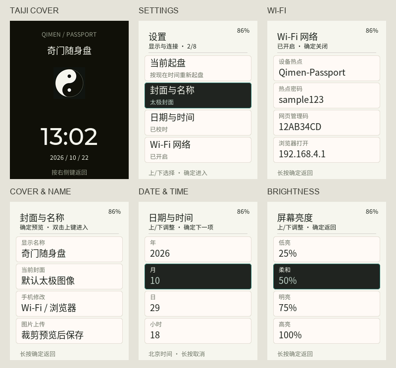

<p align="right"><strong>English</strong> · <a href="README.zh_CN.md">简体中文</a></p>

# Qimen Passport

An independent offline Qimen application for the **FoloToy AI Passport, ESP32-C3, 240×320 display, 8 MB Flash, no PSRAM**. No account, cloud interpretation or paid API is required. Derived from the FoloToy MIT board-support baseline and the locally tested Qimen implementation. It contains no vocabulary reader, book upload, personal badge, owner profile or preconfigured private network.


Cover illustration; not a photograph or exact screen capture.


## UI preview



[Phone webpage preview](assets/images/web-mobile-0.3.0.png). These are software-rendered previews.

## Features

Source revision 0.3.1 adds a reusable Taiji cover, a user-configurable name, optional full-image uploads, and four-row settings cards. The public 0.2.0 release remains unchanged. Names and images are stored locally; no private identity is prefilled.


- Beijing time (UTC+8), supported civil years 2024–2099; frozen four-pillar/hour chart snapshots.
- Nine palaces, heaven/earth/hidden stems, stars, doors, gods, chiefs, void and travelling horse.
- Previous/next two-hour charts, preserving minutes/seconds and recomputing date/term boundaries.
- Palace detail with growth stages, month/day/hour five-element strengths and colored tomb/punishment/forced-door states.
- Seven separate symbol articles: palace → heaven stem → earth stem → hidden stem → door → star → god. Line scrolling, explicit end-of-article paging and reverse navigation. Article pages hide the pillars/date/status bar and show seven category buttons. On entry, Up/Down selects a category and OK enters reading. While reading, OK returns focus to categories; long OK returns to palace detail.
- Complete on-device year/month/day/hour/minute editing, optional Wi-Fi webpage/USB/BLE time sync and Wi-Fi SNTP.
- On-demand own BLE configuration, authenticated local webpage, brightness and a dim Taiji or custom-image cover.

## Buttons

| Screen | Operation |
| --- | --- |
| Grid | Up/down: select palace or Previous/Next; OK: activate; long up/down: adjacent chart; double OK: current chart |
| Grid | Long OK: settings; double Up: cover standby |
| Palace detail | Down or OK: symbol articles; Up or long OK: grid |
| Symbol article | Up/down: one text line; one additional Down at the end: next article; Up at the top: previous article's end |
| Symbol article | OK: category selection; long OK: palace detail; first article's top-Up: detail; final article stops at its end |
| Settings | Up/down select; OK enter; long OK return |
| Local clock | Up increases / Down decreases selected field; OK advances and saves after minutes; long OK cancels |
| Standby | First right-key gesture only wakes; no accidental navigation |

After 60 seconds of inactivity, the low-brightness cover with a live clock appears. The BLE configuration page keeps its active setup window awake. This is display standby, not deep sleep. A power cycle loses the clock anchor: synchronize or explicitly set a complete date again. The editor's initial date is a placeholder, never an automatically trusted current time.

## Wi-Fi and time

Long OK → Wi-Fi settings → OK enables the device hotspot. Its name is `Qimen-Passport`; **password is randomly generated**, displayed on the board along with an eight-digit management code. Join it and open `http://192.168.4.1`. Enter the management code to synchronize phone time, recast or configure an external 2.4 GHz network. The page runs locally with no remote assets. Foreground automatic time sync runs every 30 seconds. Background browsers are not reliable clock services.

External Wi-Fi credentials are committed after matching IP acquisition. Success requires the returned request ticket's `CONNECTED` result, not just an acknowledgement. No saved network is shipped. New `qimen_app` / `qimen_net` NVS namespaces do not read the vocabulary application's personal/network namespaces.

## BLE and USB

Long OK → Bluetooth time opens a three-minute window. A generic BLE client must subscribe to TX, write the six-digit on-screen AUTH code and then send TIME using its current UTC Unix seconds. BLE system settings alone do not send time or Wi-Fi credentials. iPhone Safari does not provide this client; use the local Wi-Fi page or a suitable BLE application. This project does not ship a WeChat Mini Program or signed iPhone app. See [protocol](docs/PROTOCOL.md).

## Cover settings

Enable Wi-Fi on the device, join Qimen-Passport and open `http://192.168.4.1`. Enter the displayed management code. The Cover tab lets you save a name (up to eight supported characters), crop/zoom an image, save it, or restore the default Taiji cover without changing the name. An empty name uses the app title. Unsupported glyphs are rejected. Images are converted on the phone to 240×320 RGB565 and streamed into an inactive bank; CRC validation and a final commit preserve the previous image on interruption.

The cover briefly appears at boot and returns on double-Up or through Settings → Cover. A right-side key wakes the device. The new app partition ends at 0x380000, followed by a 512 KiB two-bank cover partition ending at 0x400000. Existing wordbook storage from 0x400000 is untouched. A partition change requires reviewed partition-table and application updates, with a recovery backup; an app-only flash is insufficient.

## Build

Install and activate **ESP-IDF 5.5.3** and the ESP32-C3 toolchain. Managed dependencies are pinned in `dependencies.lock`. Host tests need Python 3, a C compiler and Node.js for the webpage tests.

```sh
./tools/validate.sh --static
./tools/validate.sh --firmware
# Or both:
./tools/validate.sh
```

Optional actual-LVGL desktop render (after Managed Components are installed; CMake and Ninja required):

```sh
cmake -S tests/native -B build/native -G Ninja
cmake --build build/native
mkdir -p build/previews
build/native/preview build/previews
```

This checks the real 240×320 renderer with a 48 KiB LVGL pool and writes PPM previews.

Source: https://github.com/FelixXin/qimen-passport · Derived from https://github.com/FoloToy/ai-passport (MIT).

The firmware gate builds from tracked `sdkconfig.defaults` in an isolated directory, verifies image offsets/partitions, and produces `build/FoloToy-AI-Passport-full.bin` plus the matching ELF/MAP/hash archive in `build/firmware/`. The embedded project filename follows the upstream tooling; the application version starts at 0.2.0 independently of the earlier mixed firmware.

For a fresh install, use the verified **merged full image at offset 0x0**. It may clear existing settings; never flash an application-only image at 0x0. This independent layout has NVS, PHY and one application partition; no wordbook filesystem is required. Existing mixed-application updates need an explicitly reviewed segmented-flash/data-preservation plan. This project does not change or flash an attached device automatically.

## Status and scope

Version 0.2.0 is a public preview release. Build and host/native UI tests passed; this standalone version has not been validated on the physical device. It is not yet an approved community-market release. Build/host/native UI results and exact artifacts are recorded locally under `docs/RELEASE.md`. On-device acceptance of the original mixed 0.13.1 is historical evidence only; the standalone application needs its own hardware validation. BLE/Wi-Fi RF behavior, cold installation, screen brightness and power consumption must not be inferred from host tests.

The chart convention follows recorded OpenFate default four-pillar/hour observations; 12 chart fixtures and 516 calendar samples plus multi-year invariants are tested. This is not a claim of universal equivalence across schools or every website input. Month/day/hour strengths use each frozen pillar's branch as a five-element reference, not numeric energy scores. Symbol descriptions are learning notes, not automated predictions.

See [architecture](docs/ARCHITECTURE.md), [sources and licenses](docs/SOURCES.md), and [local release checklist](docs/RELEASE.md).
