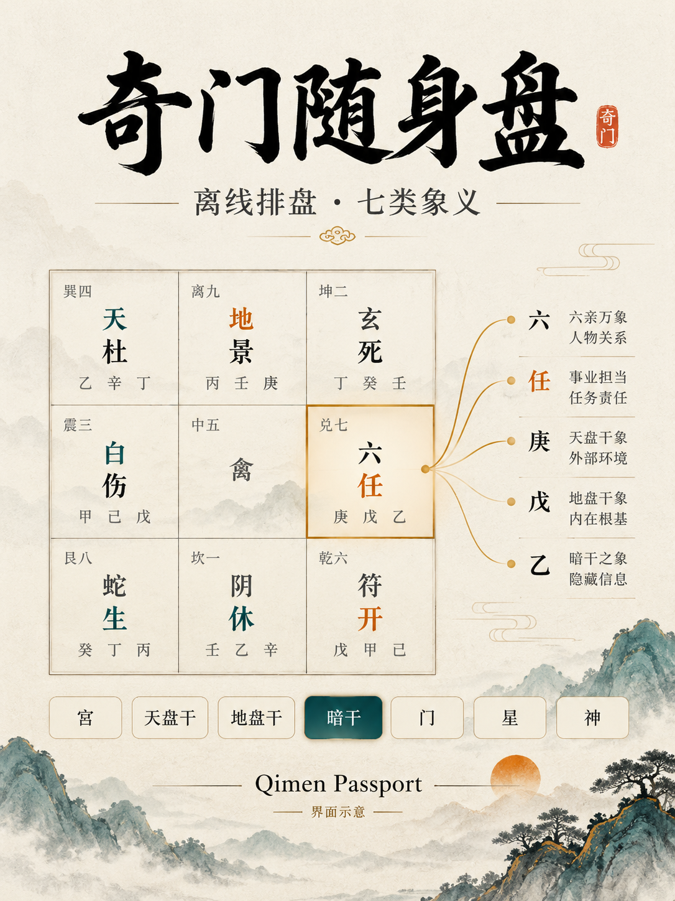
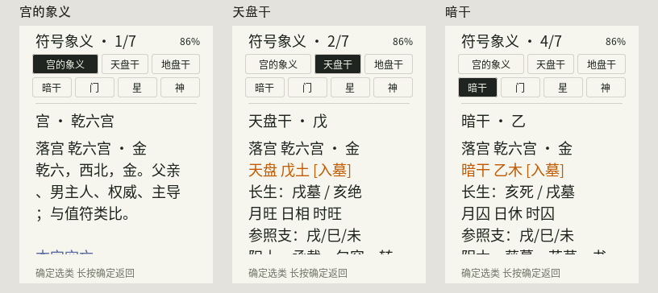
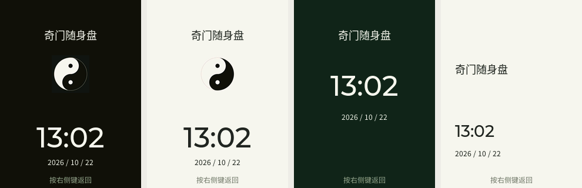

<p align="right"><a href="README.md">English</a> · <strong>简体中文</strong></p>

# 奇门随身盘 · Qimen Passport

面向 **FoloToy AI Passport（ESP32-C3、240×320 屏幕、8MB Flash、无 PSRAM）** 的独立离线奇门应用。无需账号、云端解盘或付费接口。复用 FoloToy MIT 板级驱动与已在本地验证的奇门实现；不包含背单词、词书上传或预置私人资料和网络；封面名称由使用者自行设置。



封面为插画示意，不是实拍或精确屏幕截图。



## 界面预览



[手机网页预览](assets/images/web-mobile-0.3.0.png)。以上是程序渲染预览。

## 0.4.1 更新

- 指定时间起盘：设置→指定时间起盘，输入 1900—2099 年的北京时间；上／下调整，年份长按每次十年并可连续调整，确定进入下一项，最后确定起盘。长按确定取消。此操作不校准当前时钟。
- 网页“日期时间”增加指定时刻输入；当前起盘、前后局和历史起盘均使用独立盘面快照。所有历史日期统一按公历和固定 UTC+8 解释，不模拟历史夏令时或真太阳时。
- 封面支持墨色太极、浅色太极、大字时钟、简洁名片及保留的自定义图片；板上设置页与网页均可选。选择内置样式不删除图片。名称、样式和图像断电保存。
- 对相同显示内容跳过重复布局，象义正文只在内容变化时生成；只读查询不触发重绘，电量读取至多每 30 秒一次。主机 UI 更新基准不是设备帧率承诺。
- 真实时钟校准继续限制为 2024—2099 年，避免把历史起盘时间当成当前时间。现有分区保持不变。

## 功能

- 北京时间 UTC+8，支持公历 1900—2099 年；四柱及盘面保持起盘时刻快照。
- 九宫、天地暗干、星门神、值符值使、空亡、驿马。
- 前后两小时切盘，保留分秒，跨日与节气边界重算。
- 宫位详情显示十二长生、月／日／时旺衰、入墓／击刑／门迫等颜色状态。
- 宫→天盘干→地盘干→暗干→门→星→神七篇独立象义；逐行滚动，读完再按下翻篇，可反向回看。象义页隐藏四柱、日期及状态栏，顶部为七个分类按钮。进入后上下选类、确定阅读；阅读时确定回分类选择，长按确定回宫位详情。
- 本地编辑完整年月日时分，或使用 Wi-Fi 网页、USB、自己的 BLE 协议校时；联网后支持 SNTP。
- 默认太极封面、实时日期时间；Wi-Fi 网页修改显示名称、裁剪上传自定义封面、恢复默认。
- 四行卡片式设置、独立亮度页；按需蓝牙配置及需管理码的本地网页。

## 按键

| 页面 | 操作 |
| --- | --- |
| 九宫 | 上下选宫或前后局控件，确定进入；长按上／下切前后局；双击下切下一局；双击确定进入省电休眠 |
| 九宫 | 长按确定打开设置；双击上键进入封面待机 |
| 宫位详情 | 下键或确定进入象义；上键或长按确定回九宫 |
| 符号象义 | 上下每次一行；到末尾后再按下翻篇；页首按上回上一篇末尾 |
| 符号象义 | 确定回分类选择，长按确定回详情；第一篇页首按上回详情；最后一篇不循环 |
| 设置 | 上下选择，确定进入，长按确定返回 |
| 本地校时 | 上加下减当前字段，确定切换；分钟后确定保存；长按确定取消 |
| 待机 | 第一次右侧按键只唤醒，不触发页面操作 |

无操作 60 秒后进入低亮度太极或自定义封面；蓝牙连接窗口活动期间保持设置页唤醒。这是屏幕待机，不是深度睡眠。断电会丢失时间锚点，需要重新校时。日期编辑器初值只是占位，不会自动当作当前日期起盘。

## Wi-Fi 校时

长按确定→Wi-Fi 设置→确定开启热点。热点名 `Qimen-Passport`，**密码随机生成**，与八位管理码一起显示在设备上。连接后浏览器打开 `http://192.168.4.1`，输入管理码，即可同步手机时间、重起当前盘或配置外部 2.4GHz 网络。网页全部资源保存在本地，无远程脚本；在前台时每 30 秒尝试校时，后台不保证持续同步。

外部网络获得对应 IP 后才保存凭据；以请求编号对应的 `CONNECTED` 为成功，不能把接收请求当作配置成功。发布源码不附带已保存网络。新设置使用 `qimen_app` / `qimen_net` 命名空间，不读取阅读器的个人资料或网络设置。

## 蓝牙与 USB

长按确定→蓝牙校时，开启三分钟窗口。通用 BLE 客户端订阅 TX 后，先发送屏幕六位 AUTH 码，再发送手机当前 UTC 秒数 TIME。手机系统蓝牙设置不会自行发送时间或 Wi-Fi 密码。iPhone Safari 不提供此蓝牙客户端，可使用 Wi-Fi 网页或适合的 BLE 应用。本项目不提供微信小程序和已签名 iPhone App。详见[协议说明](docs/PROTOCOL.zh_CN.md)。

## 构建

安装并激活 **ESP-IDF 5.5.3** 与 ESP32-C3 工具链，依赖固定在 `dependencies.lock`。主机测试需要 Python 3、C 编译器，网页测试需要 Node.js。

```sh
./tools/validate.sh --static
./tools/validate.sh --firmware
# 或一次运行两项：
./tools/validate.sh
```

可选的实际 LVGL 桌面渲染（先安装 Managed Components，另需 CMake 和 Ninja）：

```sh
cmake -S tests/native -B build/native -G Ninja
cmake --build build/native
mkdir -p build/previews
build/native/preview build/previews
```

此项使用真实 240×320 渲染代码与 48KiB LVGL 池，输出 PPM 预览。

固件门禁使用已登记默认配置在隔离目录构建，检查分区和镜像，生成 `build/FoloToy-AI-Passport-full.bin` 及 `build/firmware/` 内匹配的 ELF、MAP、校验值。产物文件名沿用上游工具约定；独立应用从 0.2.0 计版本，与之前混合版分开。

新设备使用已校验的**完整合并镜像，从 0x0 写入**；这可能清除原有设置。应用单体镜像不能写到 0x0。独立版含 NVS、PHY、单应用和双槽封面分区，无词书文件系统依赖。应用位于 0x10000—0x380000；封面位于 0x380000—0x400000，不触及旧混合版从 0x400000 开始的词书。分区变化后不能只刷应用；已有设备需核对并更新分区表，先保存可恢复备份。现有混合版升级需另外审核分段写入与资料保留方案，本项目不会自动修改或刷写设备。

## 封面设置

设置→Wi-Fi 网络开启热点，手机连入后打开 `http://192.168.4.1`，填入管理码。在“封面”页填写最多 8 个字的名称并保存；留空使用“奇门随身盘”。名称须在设备字库中，未覆盖的文字会拒绝保存。选取图片后居中裁剪、缩放，确认预览后保存。图片在手机上转换成固定 240×320 RGB565，设备逐块写入备用槽并校验，成功后切换；断电、中断或校验失败继续保留上一张。名称独立保存，恢复太极封面不会清除名称。

开机会短暂显示封面，再进入奇门；双击上键或设置→封面与名称→确定可再次查看，右侧键唤醒返回。名称和图片保存在本机，不含默认私人资料。

## 当前状态与边界

0.4.1 已在 AI Passport 原板安装并验收封面选择、确定预览、唤醒和英文移除；写入校验、USB 版本读取、校时通过。1900／2099 年起盘与当前时钟隔离已在 0.4.0 检查。无线连接、全范围历史盘一致性、首次完整安装和功耗仍不属于此次验收。封面为插画示意，另附实际程序渲染预览。 官方社区 0.4.1（修订 4093）已通过审核；本次准备向原作品 1758 更新 0.5.0，投稿状态见发布说明。完整操作见[使用说明](docs/GETTING_STARTED.zh_CN.md)，产物校验值见[发布说明](docs/RELEASE.zh_CN.md)。

排盘口径对照 OpenFate 默认四柱＋时家的已记录结果；测试含 12 组盘面、516 组历法样本及多年逐小时约束，不代表全部网站输入或其他流派一致。月日时旺衰各以本盘对应柱支为五行参照，不计算能量百分比。象义用于符号学习，不生成自动断语。

参见[结构](docs/ARCHITECTURE.zh_CN.md)、[来源与许可](docs/SOURCES.zh_CN.md)、[发布准备](docs/RELEASE.zh_CN.md)。

### 0.4.1 封面按键修复

封面选择改为上／下键按下即移动，后续单击／双击通知不再重复移动或吞掉选择。保留名称、图像和时钟，移除设备封面及网页封面预览顶部的英文字样。

同时修正唤醒防误触状态：在记录下一次按下前退出已到期的保护，避免封面预览唤醒后持续拦截实体按键。

## 0.5.0 省电休眠

- 在已唤醒的任意页面双击右侧确定键，先等待无线退出、按键松开，再关闭屏幕、背光和外设，进入深度休眠。原“双击确定起当前盘”改为设置菜单第一项“当前起盘”；双击上键仍查看封面。
- 休眠期间处理器不执行应用、无界面刷新、无 Wi-Fi／蓝牙服务，也不定时唤醒；内部 RTC 继续计时。按任意右侧键唤醒，设备重新初始化后恢复原页面、历史盘快照及经过休眠时间后的时钟；唤醒这次按键不执行页面操作。
- 名称、封面、词书及网络设置不擦除，分区不变。时间和盘面恢复快照只放 RTC 内存，不在每次休眠时写入闪存。已开启的 Wi-Fi 按原偏好在唤醒后恢复，临时蓝牙连接需重新开启。
- 进入休眠前无线退出失败会保持清醒并提示重试；外设交回后的失败会重启恢复，保留此次时间与盘面。
- 低亮度封面仍是显示待机，不等同省电休眠。左侧硬件电源键保留原来的长按开关机；彻底断电后 RTC 无法继续走时，需重新校时。
- 原板已验收休眠、唤醒、时间连续和封面；实际待机电流、续航及长时间时钟漂移尚未测量。
